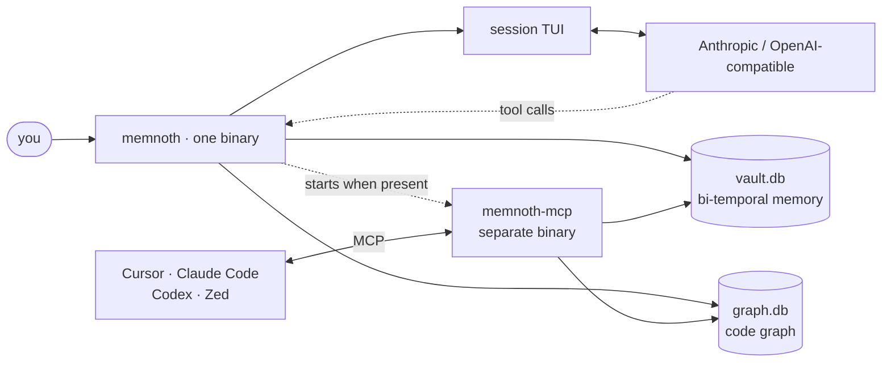

<p align="center">
  
</p>

<h1 align="center">memnoth</h1>

<p align="center">
  <strong>A terminal agent with a memory that has a past.</strong><br />
  One binary for the session, the bi-temporal vault, and the code graph — local SQLite, no daemon.<br />
  The same brain over MCP for Cursor, Claude Code, Codex, and Zed.
</p>

<p align="center">
  <a href="https://github.com/astrivya/memnoth/actions/workflows/cli-ci.yml"></a>
  <a href="https://github.com/astrivya/memnoth/releases"></a>
  
  
  
  
</p>

<p align="center">
  <a href="#quickstart">Quickstart</a> ·
  <a href="#what-it-does">What it does</a> ·
  <a href="#how-it-fits-together">Architecture</a> ·
  <a href="#use-it-from-your-editor">MCP</a> ·
  <a href="#commands">Commands</a> ·
  <a href="#build-and-contribute">Contributing</a>
</p>

Memnoth is a local-first coding agent that remembers **when** things were true. It keeps decisions, corrections, and the reasons behind them in a temporal vault; keeps a graph of what your code declares and what mentions it; and exposes both to a model, a shell, or your editor.

No account. No service to start. The vault, the graph, and the session are files you own.

## Install

| You have | Install |
| --- | --- |
| **Linux / macOS** | `curl -fsSL https://memnoth.astrivya.ai/install | bash` |
| **Windows (Git Bash / WSL / MSYS2)** | `curl -fsSL https://memnoth.astrivya.ai/install | bash` |
| **Windows (PowerShell / CMD)** | Download `memnoth-x86_64-pc-windows-msvc.zip` from [Releases](https://github.com/astrivya/memnoth/releases) |
| **Rust toolchain** | `git clone https://github.com/astrivya/memnoth && cd memnoth/CLI && cargo install --path .` |
| **Editor only (MCP)** | `npx -y @astrivya/mcp` — bundles the server, no separate install |

The installer verifies the release checksum and installs two names for one binary: `memnoth` and `mn`.

## Quickstart

```bash
# 1 · see what this machine already has
memnoth doctor

# 2 · create the vault (idempotent, once per machine)
memnoth vault init

# 3 · index this workspace (incremental after the first run)
memnoth kg index

# 4 · open the session
memnoth
```

That is the whole setup. No auth flow, no server to keep alive.

Then ask questions with commands that can also be scripted:

| Question | Command |
| --- | --- |
| What did we believe on 2026-09-01? | `memnoth vault asof --at 2026-09-01` |
| Why did this decision change? | `memnoth vault history auth` |
| What breaks if I change `PaymentRetrier`? | `memnoth kg impact PaymentRetrier` |
| Where is `open_vault` declared? | `memnoth kg search open_vault` |
| What do we know about retries? | `memnoth vault recall retries` |

**No API key? It still works.** The session answers from the vault and the graph, and tells you which store answered. Export `MEMNOTH_API_KEY` (or `ANTHROPIC_API_KEY` / `OPENAI_API_KEY`) and a model drives the same tools, printing every lookup it makes.

## What it does

### Memory that keeps its history

Facts are observations attached to entities. Entities and relations carry `valid_from` / `valid_to`; observations carry the date they became true. Correcting a belief closes the old window and opens a new one — nothing is overwritten.

- `asof` reconstructs what was believed at any instant.
- `history` shows every version of one belief, with the reason each window closed.
- `contradictions` keeps both sides of an explicit revocation instead of averaging them into an answer true of neither.
- Repeating the same fact on the same day is idempotent — no duplicate that reads as corroboration.

Search is hybrid FTS + graph, so `recall` finds the decision, not just the word. `remember` accepts `fact`, `decision`, `lesson`, `gotcha`, or `correction` (confidence defaults to `0.9`); an unknown kind is refused rather than stored.

### A code graph, not just grep

`kg index` walks the workspace and stores files, declarations, and references in SQLite. `kg impact` answers the question that matters before a refactor: where is this defined, who mentions it, which tests touch it, and what else moves one hop away.

The index is incremental by file size and mtime, and it is a derived artifact — deleting `.memnoth/graph.db` is always safe.

### A session that shows its work

A plain question runs a model turn when a provider is configured. The model's tools are the same verbs you type, so `/kg status` and `memnoth kg status` cannot drift. Every lookup is printed in the transcript; `/search` asks the two local stores directly even when a model is available.

### Local by default

| What | Where | Scope |
| --- | --- | --- |
| Vault | `~/.memnoth/vault.db` | the person and the machine |
| Code graph | `<workspace>/.memnoth/graph.db` | the repository |
| Sessions | `~/.memnoth/sessions/*.jsonl` | append-only, one message per line |
| Config | `~/.memnoth/config.toml` | endpoints and models, never a key |

The vault is per-machine because memory is about the person; the graph is per-workspace because it is about the code. Copy the vault file and you have moved your memory. The model key lives only in the environment.

### An agent with brakes

Two tools change state: `vault_remember` and `edit_file`. Neither can run until you say yes in a confirmation box; a refusal is final for that turn.

File edits stay inside the workspace (relative paths only, never `.git/` or `.memnoth/`), must replace exactly one snippet byte for byte, and refuse files that are non-UTF-8 or larger than 256 KB.

## How it fits together



Two rules hold the binary together:

- **One dispatcher.** `commands::execute` answers every verb. The TUI builds the same `Verb` for its slash commands, so there is no second implementation that can disagree.
- **One answer, two renderings.** Every verb returns text for a person and JSON for a program — the same JSON shape the MCP tool returns.

## Use it from your editor

```bash
memnoth mcp add --clients cursor,codex   # omit --clients to detect installed clients
memnoth mcp doctor                       # what is registered, with which profile, and where
```

`mcp add` writes each client's own config and preserves entries it did not create. `mcp doctor` also runs the server's own selftest, so “the config looks right” and “the server answers” are never confused.

Profiles decide which tools a host is told about:

| Profile | Tools | For |
| --- | ---: | --- |
| `micro` | 4 | the smallest useful set |
| `memory` | 21 | the vault, including the temporal quartet |
| `code` | 23 | code graph plus filesystem/git toolbox |
| `coord` | 11 | multi-agent claims, tasks, messaging |
| `full` | 48 | everything |
| `agent` | 6 | agent session management, HTTP transport only |

A tool you expected but cannot see is a profile setting, not a missing capability. The active profile and its tool count are reported in `initialize` and `mcp doctor`.

<details>
<summary><strong>Manual MCP config</strong></summary>

<br />

```json
{
  "mcpServers": {
    "memnoth": {
      "command": "npx",
      "args": ["-y", "@astrivya/mcp"],
      "env": { "MEMNOTH_MCP_PROFILE": "full" }
    }
  }
}
```

For the HTTP transport, pass the endpoint and a bearer token. `MEMNOTH_MCP_TOKEN` is the only token source; it is never written to Memnoth's config.

</details>

## Commands

| Surface | Verbs |
| --- | --- |
| **Session** | `memnoth`, `memnoth --resume <name>` |
| **Vault** | `init` · `status` · `remember` · `recall` · `asof` · `history` · `contradictions` |
| **Graph** | `index` · `status` · `impact` · `search` |
| **MCP** | `serve` · `doctor` · `add` · `call` · `selftest` |
| **Diagnostics** | `doctor` |

Global flags: `--root <dir>`, `--vault <path>`, `--namespace <name>`, `--json`, `--quiet`, `--resume <name>`. They work before or after the verb.

<details>
<summary><strong>Every command, with what it answers</strong></summary>

<br />

| Command | What it answers |
| --- | --- |
| `memnoth` | the session against the current directory's vault and graph |
| `memnoth --resume payments` | the same session, continued by name |
| `memnoth vault init` | create the vault (idempotent, once per machine) |
| `memnoth vault status` | the vault's path, size, namespace, and counts |
| `memnoth vault asof --at <when>` | what was believed at an instant (RFC 3339, a date, or epoch milliseconds) |
| `memnoth vault history <name>` | every version of one belief, with the reasons it closed |
| `memnoth vault contradictions` | beliefs explicitly revoked, both sides kept |
| `memnoth vault remember <name> -- <fact>` | record a fact, decision, lesson, gotcha, or correction |
| `memnoth vault recall <query>` | search the vault (FTS + graph + temporal windows) |
| `memnoth kg index` | build or update the code graph from the workspace |
| `memnoth kg status` | what was built, when, and how stale it is |
| `memnoth kg impact <symbol>` | definitions, references, tests, and blast radius |
| `memnoth kg search <query>` | symbols by name |
| `memnoth mcp serve` | serve the vault and graph over MCP (stdio; `--http` for loopback HTTP) |
| `memnoth mcp doctor` | what is registered, with which profile, and where |
| `memnoth mcp add --clients cursor,codex` | write a client's MCP config |
| `memnoth mcp call <tool> --args '{...}'` | one tool, through the same dispatcher a host reaches |
| `memnoth mcp selftest` | the server's own initialize/tools/list probe |
| `memnoth doctor` | which paths, stores, model, server, instructions, and sandbox policy this machine actually has |

</details>

## Configuration

```toml
# ~/.memnoth/config.toml
[provider]
kind = "anthropic"                 # or "openai": any OpenAI-compatible endpoint
model = "claude-sonnet-4-5"
# base_url = "http://127.0.0.1:8080/v1"   # a gateway or a local server
# max_tokens = 1600
# input_per_mtok = 3.0             # optional: exact session cost estimate
# output_per_mtok = 15.0
```

| Variable | What it overrides |
| --- | --- |
| `MEMNOTH_API_KEY` | the key (falls back to the provider's own variable) |
| `MEMNOTH_PROVIDER` | `provider.kind` |
| `MEMNOTH_MODEL` | `provider.model` |
| `MEMNOTH_PROVIDER_BASE_URL` | `provider.base_url` |
| `MEMNOTH_MCP_TOKEN` | bearer token for the HTTP MCP transport; never stored |

`memnoth doctor` and `/model` print the provider, model, endpoint, and whether a key is present — so “the model declined” and “no key is wired” never look the same.

### State and overrides

| What | Default | Override |
| --- | --- | --- |
| Vault | `~/.memnoth/vault.db` | `--vault`, `MEMNOTH_VAULT` |
| Vault namespace | `default` → `vault-<name>.db` | `--namespace` |
| Code graph | `<root>/.memnoth/graph.db` | `MEMNOTH_GRAPH` |
| Sessions | `~/.memnoth/sessions/<name>.jsonl` | — |
| Config | `~/.memnoth/config.toml` | — |
| State directory | `~/.memnoth` | `MEMNOTH_HOME` |
| MCP server binary | beside `memnoth`, then `PATH` | `MEMNOTH_MCP_BIN` |

## JSON for scripts

Every command that answers a question can answer a program instead:

```bash
memnoth kg status --json
```

```json
{
  "ok": true,
  "command": "kg.status",
  "version": "0.1.0-beta.1",
  "data": {}
}
```

Failures use the same envelope with `ok: false` and `error`, so a caller never parses prose to find a failure. Exit code is `0` on success and `1` on failure.

## What ships in this tree

This repository publishes the local product, and it names what is absent rather than returning an empty list that reads as “nothing found”.

| Surface | Status in this tree |
| --- | --- |
| Session, vault, doctor | Builds and ships. |
| Code graph | v1 structural index: line/regex extraction, lexical search, textual references. |
| MCP server | Separate `memnoth-mcp` binary. Its crate is excluded because five dependencies are not published here. |
| Embeddings | Not built here; `kg search` stays lexical. |

The production `memnoth-codegraph` (tree-sitter parsing, resolved call edges, communities, semantic search) is not in this repository. In its place, `kg` answers the two questions that need no resolution — *where is this declared* and *who mentions it* — and says so in its output.

The MCP server crate is excluded on purpose, not forgotten: `memnoth-codegraph`, `memnoth-ingest`, `memnoth-embedding`, `memnoth-harness-api`, and `memnoth-transport` are unpublished siblings. `memnoth mcp` drives a separate server binary when one is on the machine; `npx -y @astrivya/mcp` is the fastest way to get one. A change that makes the CLI depend on `crates/memnoth-mcp` would make this repository unbuildable again.

Run `memnoth doctor` first when something is not wired. It prints paths rather than names, so a client registered against a binary that has since moved shows up as a path that does not exist instead of an answer that looks fluent.

## Build and contribute

### From source

```bash
git clone https://github.com/astrivya/memnoth
cd memnoth/CLI
cargo build --release        # target/release/memnoth
cargo test --workspace       # binary + eleven library crates
```

Requires a current stable Rust toolchain (edition 2024).

### Project map

```text
CLI/
├── src/
│   ├── cli.rs         the command surface
│   ├── commands.rs    one dispatcher, one Outcome
│   ├── vault.rs       temporal vault verbs
│   ├── kg/            code graph: extract, store, render
│   ├── mcp/           server bridge and client registration
│   ├── tui/           session screen and line parser
│   ├── provider.rs    model transport and tool loop
│   ├── edit.rs        sandboxed, approval-gated file edits
│   └── doctor.rs      what is wired on this machine
├── crates/            eleven published library crates
│   ├── memnoth-engine        temporal graph + hybrid search
│   ├── memnoth-session       JSONL turn log
│   ├── memnoth-search        lexical code search
│   ├── memnoth-coord         multi-agent claims and tasks
│   ├── memnoth-context       instructions, budgets, compaction
│   ├── memnoth-capability    one tool registry for every surface
│   ├── memnoth-sandbox       deny-globs and policy plans
│   ├── memnoth-mcp-auth      static bearer / HS256 / RS256
│   ├── memnoth-mcp-client    MCP client (stdio + HTTP)
│   ├── memnoth-protocol-v2   length-prefixed framing
│   └── memnoth-embedding-wasm ONNX inference for WASM
└── scripts/           install.sh and dist.sh
```

### Before you open a PR

```bash
cargo fmt -p memnoth -- --check
cargo clippy -p memnoth --all-targets -- -D warnings
cargo test --workspace --locked
```

CI runs those on Linux, macOS, and Windows.

### Releases

`cli-release.yml` runs on a `v*` tag, builds the five release targets, verifies each binary's `--version`, and hands the archives to `scripts/dist.sh`. That script is the one place that knows the bundle's shape: `dist/install.sh`, versioned archives with checksums, a real `latest/` copy, and `SHA256SUMS`. The website's `/install` endpoint downloads `install.sh` rather than carrying a second copy.

### Three rules that keep the tree coherent

1. **Add a verb once.** Put it in `commands::execute`; the TUI gets it for free.
2. **Return an `Outcome`.** Text and JSON together, never a second hand-written shape.
3. **Never fabricate an answer.** If a component is absent from this build, name it. If a result is truncated, say so.

### Good places to start

- The v1 graph in `src/kg/` — extraction, reference scanning, ranking, rendering.
- The vault verbs in `src/vault.rs` and the engine semantics in `crates/memnoth-engine`.
- MCP registration and calls in `src/mcp/` and `crates/memnoth-mcp-client`.
- Docs and examples: command help, `doctor` output, and the gaps listed above.

For a large change, open an issue first so the design can be agreed before the code. Small, tested PRs are always welcome.

## License

Apache-2.0, as declared in `Cargo.toml`. The control plane in `memnoth-cloud/` is separate and proprietary; the local product does not require it.

<p align="center">
  <sub>Built in Rust. Stored in SQLite. Yours to keep.</sub>
</p>
